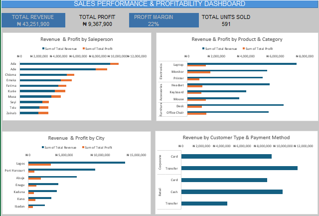

# 📊 Sales Performance & Profitability Analysis (Excel)

An end-to-end data cleaning, exploratory analysis, and interactive dashboard project built in **Microsoft Excel** to evaluate sales performance, profit margins, regional demand, and customer purchasing behavior across Nigerian retail and corporate segments.

---

## 🎯 Business Questions Answered
1. **Salesperson Performance:** Which sales representatives generate the highest total revenue and net profit?
2. **Product & Category Profitability:** Which product categories and individual SKUs drive the greatest revenue and profit margins?
3. **Regional Performance:** How do revenue and profit compare across major Nigerian commercial hubs (*Lagos, Port Harcourt, Abuja, Enugu, Kaduna, Kano, Ibadan*)?
4. **Customer Segments & Payment Behavior:** How does purchasing volume and preferred payment method (*Card, Transfer, Cash*) differ between **Retail** and **Corporate** clients?

---

## 🧹 Data Cleaning & Preparation Log
Before building PivotTables and visualizations, the raw sales dataset (`49` transaction records) underwent structured cleaning and feature engineering:
* **Missing Numerical Imputation:** Identified missing `Unit Price` records (e.g., *Desk* in Furniture and *Monitor* in Electronics) and accurately imputed values (`₦120,000` and `₦210,000`) using exact product-level lookup matching against fixed wholesale `Unit Cost`.
* **Missing Categorical Imputation:** Imputed missing `Payment Method` entries using the statistical mode (**`Card`**).
* **Whitespace & Duplicate Entity Resolution:** Detected and trimmed trailing whitespace in the `Salesperson` field (`"Kunle "`), merging fragmented records into a single accurate entity.
* **Feature Engineering:** Created calculated columns for financial analysis:
  * `Total Revenue = Quantity Sold × Unit Price × (1 - Discount %)`
  * `Total Cost = Quantity Sold × Unit Cost`
  * `Total Profit = Total Revenue - Total Cost`

---

## 💡 Key Business Insights
* **Top-Line vs. Bottom-Line Leaders:** **Ada** led all salespersons in total revenue (**₦9,289,800**), while **Ade** generated the highest net profit (**₦1,198,050**) due to lower discounting and higher-margin product sales.
* **Category & Product Drivers:** **Electronics** was the top-performing category (**₦18,002,400** revenue; **₦3,714,550** profit), led by **Laptops** and **Monitors**, followed by **Accessories** (**₦13,155,250**) and **Furniture** (**₦12,094,250**).
* **Regional Dominance:** **Lagos** (**₦13,427,100** revenue; **₦3,186,450** profit) and **Port Harcourt** (**₦9,289,800** revenue) accounted for over **52%** of total company revenue.
* **Customer & Payment Preferences:** **Corporate** clients strongly favored **Bank Transfers** (nearly ₦10M in revenue), whereas **Retail** customers relied primarily on **Cash** and **Card** payments.

---

## 🛠️ Tools & Techniques Used
* **Microsoft Excel:** Data Cleaning (`Find & Replace`, `Go To Special`, Mode & Lookup Imputation), Financial Formulas, PivotTables, PivotCharts, Custom Currency Formatting (`₦`), and KPI Cards.

---

## 📁 Repository Structure
* `Sales-Data.xlsx` — Cleaned dataset, PivotTables, and executive Dashboard.
* `dashboard.png` — High-resolution preview of the final Excel dashboard.
* `README.md` — Project documentation, cleaning log, and key findings.

